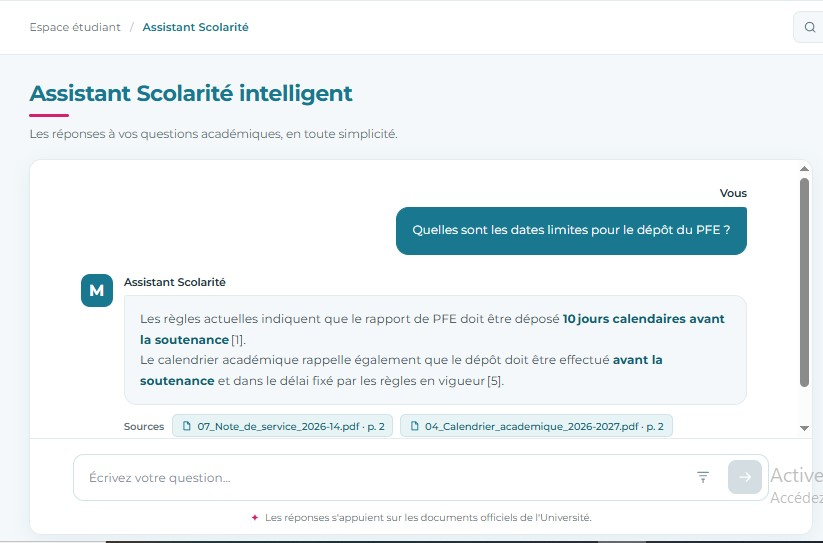
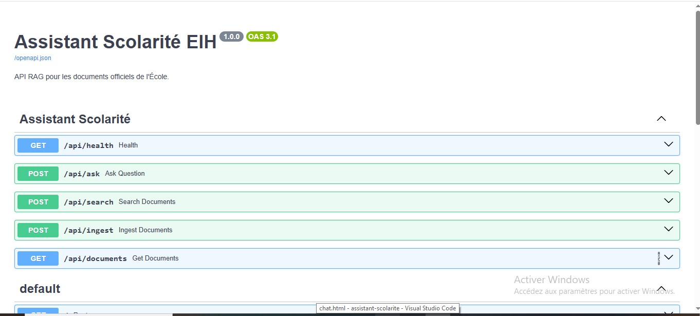
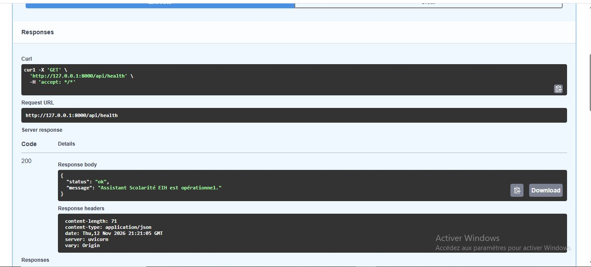
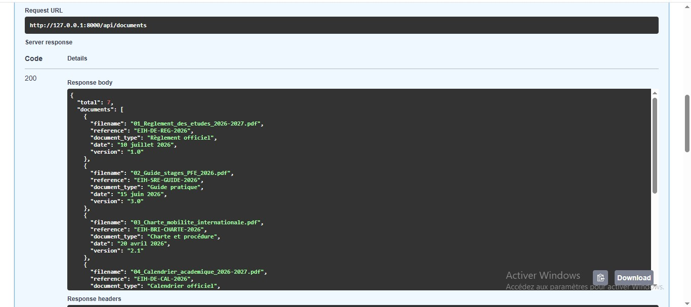
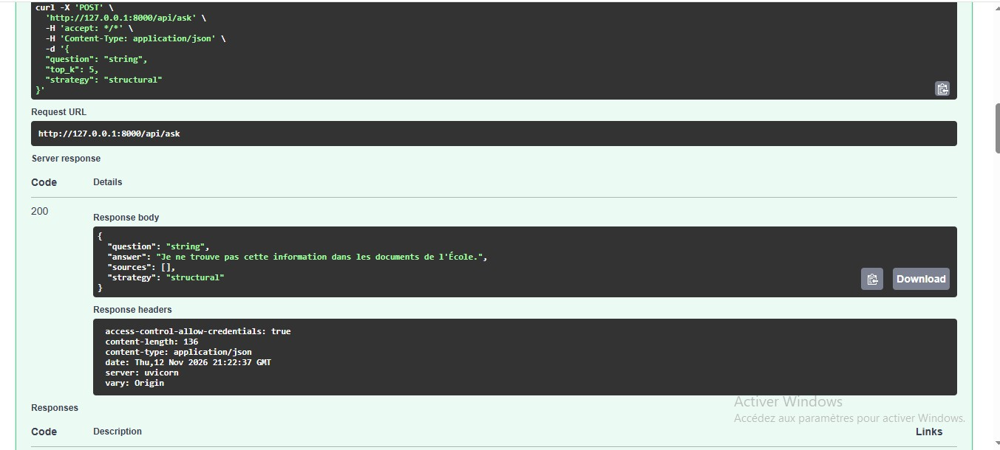
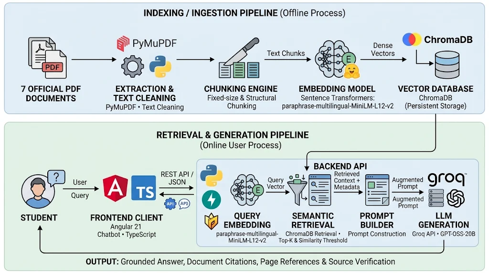
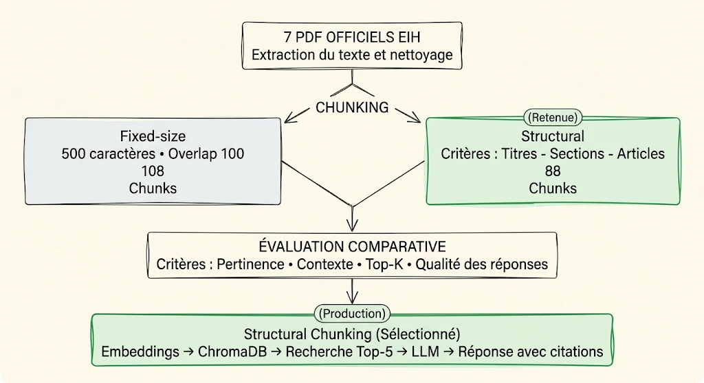
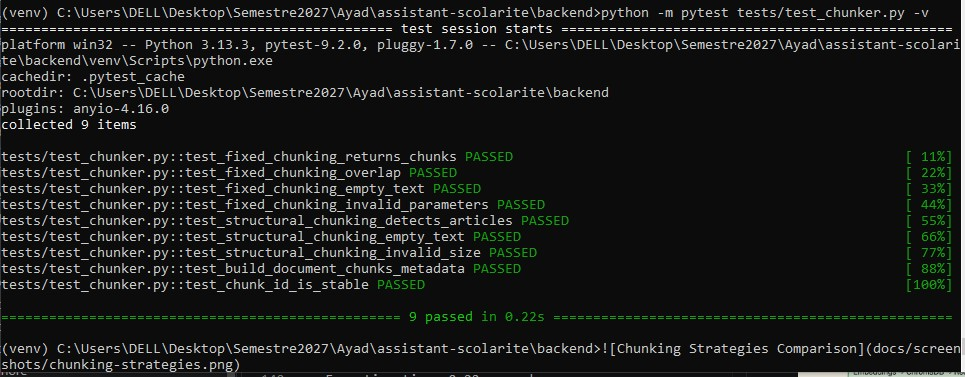

# 🎓 Assistant Scolarité 

An intelligent academic and administrative assistant powered by **Retrieval-Augmented Generation (RAG)**, designed to facilitate access to official information from the École d'Ingénieurs Hélianthe (EIH).

The application allows students to ask questions in natural language and receive contextualized answers generated from the school's official documents.

By combining semantic search with a Large Language Model (LLM), the system retrieves relevant document passages before generating answers supported by documentary references and page citations.

---

## 🎯 1. Project Objectives

- Centralize access to academic and administrative information.
- Allow students to query official documents using natural language.
- Generate contextualized answers with document references and page citations.
- Reduce unsupported answers through a refusal mechanism when information is unavailable in the knowledge base.
- Explore semantic retrieval and Retrieval-Augmented Generation techniques.

## ✨ 2. Key Features

- **Natural Language Question Answering:** Ask academic and administrative questions in natural language.
- **Document-Based Responses:** Generate answers using retrieved passages from official EIH documents.
- **Source Citations:** Display document references, page numbers and relevant excerpts.
- **Out-of-Corpus Handling:** Refuse questions when the requested information is not available in the knowledge base.
- **Semantic Search:** Retrieve relevant document chunks using vector similarity.
- **Multiple Chunking Strategies:** Implement Fixed-size and Structural chunking.
- **REST API:** Expose the RAG pipeline through FastAPI endpoints.
- **Interactive Web Interface:** Provide a conversational interface built with Angular.

## 📚 3. Knowledge Base

The system relies on a corpus of **7 official PDF documents** covering academic and administrative regulations.

| Document | Description |
|---|---|
| Règlement des études 2026-2027 | Academic regulations |
| Guide des stages et du PFE | Internship and final-year project guidelines |
| Charte de mobilité internationale | International mobility regulations |
| Calendrier académique 2026-2027 | Academic calendar |
| Guide de la vie étudiante | Student life information |
| FAQ Scolarité | Frequently asked academic questions |
| Note de service n° 2026-14 | Updated academic and internship rules |

The documents are processed and indexed to build the application's searchable knowledge base.

## 🖥️ 4. Application Preview

### Chatbot Interface

The application provides an interactive conversational interface where students can ask questions about academic and administrative information.


### RAG Response with Document Citations

Answers are generated using relevant passages retrieved from official EIH documents. Each response includes references to source documents and page numbers.



### API Documentation — Swagger UI

The backend REST API is documented and testable through Swagger UI.



### API Health Check



### Retrieved Documents



### RAG API Response



### Technical Architecture



## 🏗️ 5. Technical Architecture

The application follows a Retrieval-Augmented Generation (RAG) architecture, separating document ingestion from the question-answering process.

### Offline Pipeline — Document Ingestion

1. Load the official PDF documents.
2. Extract text and page information using PyMuPDF.
3. Clean and preprocess extracted content.
4. Split documents using Fixed-size and Structural chunking strategies.
5. Generate vector embeddings using Sentence Transformers.
6. Store embeddings, text chunks and metadata in ChromaDB.

### Online Pipeline — Question Answering

1. The student submits a question through the Angular interface.
2. FastAPI receives and validates the request.
3. Sentence Transformers generates the question embedding.
4. ChromaDB retrieves the most relevant document chunks.
5. A similarity threshold determines whether the retrieved context is sufficient.
6. The retrieved passages are incorporated into a prompt.
7. The LLM generates a contextualized answer.
8. The API returns the answer and its associated source references to the frontend.

## 🔍 6. Technical Choices

| Component | Technology | Justification |
|---|---|---|
| Frontend | Angular 21 | Build an interactive and responsive chatbot interface. |
| Backend | FastAPI | Develop REST API endpoints and provide automatic API documentation. |
| Data Validation | Pydantic | Validate API requests and responses. |
| PDF Extraction | PyMuPDF | Extract text and page information from PDF documents. |
| Text Chunking | Fixed-size & Structural Chunking | Compare two document segmentation strategies. |
| Embedding Model | Sentence Transformers — paraphrase-multilingual-MiniLM-L12-v2 | Generate multilingual semantic embeddings. |
| Vector Database | ChromaDB | Store and retrieve document embeddings. |
| Retrieval | Semantic Search (Top-K = 5) | Retrieve the five most relevant chunks. |
| LLM Provider | Groq API | Provide access to the language model. |
| Language Model | GPT-OSS-20B | Generate contextual answers from retrieved passages. |
| Configuration | Environment Variables (.env) | Store application settings and API credentials. |

## ✂️ 7. Chunking Strategies

Two chunking strategies were implemented to compare different approaches to document segmentation.

### Fixed-size Chunking

- Splits document text into chunks of 500 characters.
- Uses an overlap of 100 characters between consecutive chunks.
- Provides a simple and consistent segmentation approach.

### Structural Chunking

- Detects document headings, articles, chapters and sections.
- Groups content according to its document structure.
- Uses a maximum chunk size of 500 characters in the current comparison configuration.

### Chunking Comparison



The two strategies are indexed separately in ChromaDB to allow comparative retrieval experiments.

**Current indexing results:**

| Strategy | Indexed Chunks |
|---|---:|
| Fixed-size | 108 |
| Structural | 88 |

Structural Chunking is currently selected for the chatbot pipeline. Its retrieval quality will be assessed through the dedicated evaluation process.

## 📁 8. Project Structure

The project is organized into separate backend, frontend, data and evaluation modules.

```text
assistant-scolarite/
│
├── backend/
│   ├── app/
│   │   ├── api/
│   │   ├── ingestion/
│   │   ├── retrieval/
│   │   ├── generation/
│   │   ├── main.py
│   │   └── rag_pipeline.py
│   │
│   ├── tests/
│   ├── requirements.txt
│   └── .env.example
│
├── frontend/
│   └── src/
│
├── data/
│   ├── raw/
│   ├── cleaned/
│   └── chunks/
│
├── docs/
│   └── screenshots/
│
├── eval/
│   ├── questions.jsonl
│   └── run_eval.py
│
└── README.md
```

*The structure above is illustrative; adapt it to the actual files and directories in the repository.*

## ⚙️ 9. Installation & Configuration

### Prerequisites

- Python 3.11 or later.
- Node.js and npm.
- Angular CLI.
- Git.

### Clone the Repository

```bash
git clone <repository-url>
cd assistant-scolarite
```

### Backend Setup

```bash
cd backend

python -m venv venv
```

Activate the virtual environment on Windows:

```cmd
venv\Scripts\activate
```

Install dependencies:

```bash
pip install -r requirements.txt
```

### Environment Variables

Create a `.env` file inside the backend directory:

```env
GROQ_API_KEY=your_groq_api_key
GROQ_MODEL=openai/gpt-oss-20b
```

**Important:** Never commit the `.env` file or expose API credentials in the repository.

### Frontend Setup

Open another terminal:

```bash
cd frontend
npm install
```

## 🚀 10. Running the Application

### Start the Backend

From the `backend` directory:

```bash
venv\Scripts\activate
python -m uvicorn app.main:app --reload
```

Backend URL:

`http://127.0.0.1:8000`

Swagger documentation:

`http://127.0.0.1:8000/docs`

### Start the Frontend

From the `frontend` directory:

```bash
ng serve
```

Frontend URL:

`http://localhost:4200`

## 🔌 11. API Documentation

The backend exposes REST endpoints through FastAPI.

| Method | Endpoint | Description |
|---|---|---|
| GET | `/api/health` | Check API and vector database status. |
| POST | `/api/ingest` | Process and index the document corpus. |
| GET | `/api/documents` | Retrieve indexed document information. |
| POST | `/api/search` | Retrieve relevant document chunks without generation. |
| POST | `/api/ask` | Execute the complete RAG question-answering pipeline. |

Interactive API documentation is available at:

`http://127.0.0.1:8000/docs`

## 🧪 12. Testing & Evaluation

### Unit Testing — Chunking Module

The chunking module was tested using **pytest** to verify the correctness of both Fixed-size and Structural chunking strategies.

The test suite covers:

- Fixed-size chunk generation and chunk overlap.
- Handling of empty input text.
- Validation of invalid chunking parameters.
- Structural detection of document articles.
- Preservation of document metadata in generated chunks.
- Stability of chunk identifiers.

**Execution:**

```bash
python -m pytest tests/test_chunker.py -v
```

**Test Results:**

| Metric | Result |
|---|---:|
| Total tests | 9 |
| Passed | 9 |
| Failed | 0 |
| Execution time | 0.22 seconds |



### RAG Evaluation

A dedicated evaluation dataset is planned to assess retrieval quality and answer generation.

The evaluation will cover:

- Single-document questions.
- Multi-document synthesis questions.
- Questions involving updated regulations.
- Out-of-corpus questions.

The following metrics will be used:

| Metric | Purpose |
|---|---|
| Hit@k | Measures whether a relevant chunk appears among the top-k retrieved results. |
| MRR (Mean Reciprocal Rank) | Measures the ranking position of the first relevant result. |
| Answer Accuracy | Evaluates the correctness of generated answers. |
| Source Faithfulness | Checks whether generated claims are supported by retrieved passages. |
| Correct Refusal Rate | Measures the ability to refuse questions outside the knowledge base. |
| False Refusal Rate | Measures incorrect refusals for answerable questions. |

A comparative evaluation of Fixed-size and Structural chunking will be conducted using the same evaluation questions.

## 🚧 13. Limitations & Future Improvements

Potential improvements include:

- Expanding the automated evaluation dataset.
- Comparing retrieval strategies using Hit@k and MRR.
- Evaluating answer accuracy and source faithfulness.
- Improving PDF table extraction and structural segmentation.
- Adding more advanced retrieval techniques, such as hybrid search and reranking.
- Enhancing monitoring and performance analysis.

## 👩‍💻 14. Author

**Nadya El Abbassi**

Engineering Student — Computer Science  
Specialization: Data Science & Artificial Intelligence

Mundiapolis University — Casablanca

